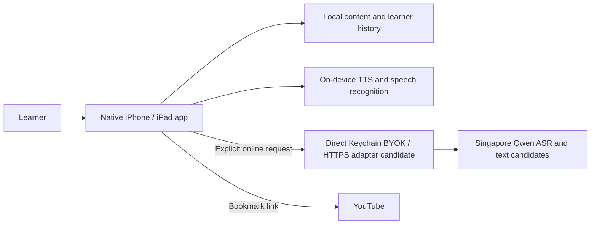

# System Context

> v2 (2026-10-25). Online AI is Phase 6; everything else is on the device.

Local basic study, recording and self-review are confirmed goals. Developer-owned provider credentials must never be bundled. Learner BYOK credentials are stored in Apple Keychain and used only for the chosen provider. The integration node denotes an adapter; a backend is conditional. Opening a video link does not authorize content extraction. Sync and realtime conversation are deferred.
