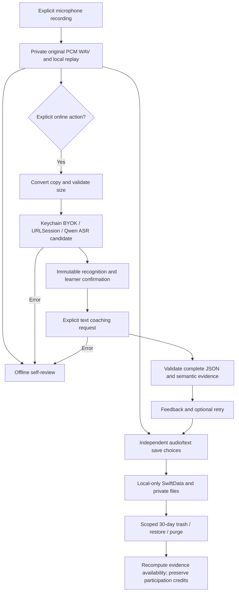
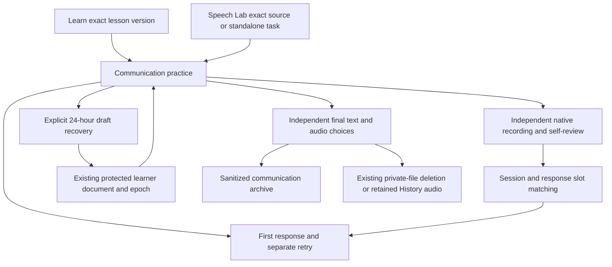

# Recorded Feedback Data Flow

> **v2 note (2026-10-25):** kept for online AI coaching, which is now Phase 6 in the [development plan](../development-plan/development-plan.md). Sections that mention v1 tickets, Speech Lab trainers or delivery groups are history; see [history-version.md](../history-version.md).

> Status: IN_PROGRESS. SC-T002–SC-T004 design selected 2026-10-21; no runtime proof.

Transport is a documentation-backed candidate; account terms/quota and real-device proof remain open. No backend/public hosting/automatic upload or retry. All learner data requests backup exclusion. See [architecture](../history/v1/tdd/tdd.md) and [retention contract](../contracts/recorded-feedback-v1.md); store/files are separate transactions with reconciliation. No application implementation authorized.

## Local communication preview — 2026-10-24

The owner-authorized [SC-D014 integration](../history/v1/development-plan/sc-d014-integration-2026-10-24.md) adds this local path; the earlier diagram's online edges remain gated.

No edge completes a course, changes a vocabulary schedule, awards mastery or sends audio/text to a provider. Missing published references, adopted feedback contracts and actual acceptance remain separate.

## Resource library flow — SC-D017

Learn → resource library → explicit Save → canonical URL/duplicate/revision/epoch checks → existing protected learner document. Editor drafts stay in controller memory until Save/Discard. Bookmark/source card → validated open intent → destination disclosure/confirmation → epoch/revision recheck → system URL handler. Network-path observation supplies offline state without a website request. No resource/notes path reaches provider adapters or curriculum/scheduler/reward writes. See [contract](../contracts/resource-library-v1.md).

## Generated-practice local boundary — SC-D015

Speech Lab → GeneratedPracticeHost → current learner epoch and journal → unknown-outcome recovery/expiry → local presentation. Explicit save/removal → prepared final record → epoch and exact-prior-record validation → existing protected learner document; failed writes retain previous durable state. A future supplied transport must separately pass approved policy/account, request identity and save-before-send boundaries. The production host currently supplies no policy or transport. Return data must match frozen source/policy/requested kind before structural validation; local generated practice cannot write curriculum/scheduler/reward outcomes. See [review and remaining scope](../history/v1/development-plan/sc-d015-integration-2026-10-25.md).

## SC-D016 local discovery and daily pin

Vocabulary → memory-only discovery choices → unavailable production generation. Synthetic request fixtures → SC-D015 pinned epoch/policy/source/request state machine → single validated candidate → reveal/edit/select; collection/review remains blocked. Cancel/leave/background drops preview consumption; learner replacement/restart drops private discovery choices.

Today → current local day/epoch → existing protected optional daily pin → exact reviewed-pool match or honest empty state. Internal explicit pin persistence → epoch/exact-prior-record checks → existing learner document; failed writes preserve the prior pin and reset invalidates old saves. No production selector or reviewed pool is supplied. Day/clock changes never rotate, enroll or award a word.

## SC-D005 reward flow — 2026-10-25

Reviewed lesson transition / rated sense-review event / recorded self-review → source identity + exact activity/version + pinned local date → reward reconciliation inside the existing protected learner transaction → committed wallet/award receipts → Today/Progress/session result views. Completion/replay/Continue do not mint another reward. User opens an optional tool → shows current cost/balance and affected dates → Cancel leaves state untouched / Confirm rechecks epoch, revision, date, budget and cost → one committed debit, then visible help/inventory/protection. Failed writes expose retry and preserve prior state.

Minute/activity goals are distinct from an explicit daily lesson plan. A shared foreground engagement owner samples time once; idle/background pauses do not create activity credit. User-enabled selected-day/time reminders schedule one generic local request after permission and epoch/settings checks; completion/disable/reset cancel it. No notification, display or timer completion finishes a lesson or creates currency. No network/provider/export is added. [Delivery](../history/v1/development-plan/sc-d005-2026-10-25/README.md).
