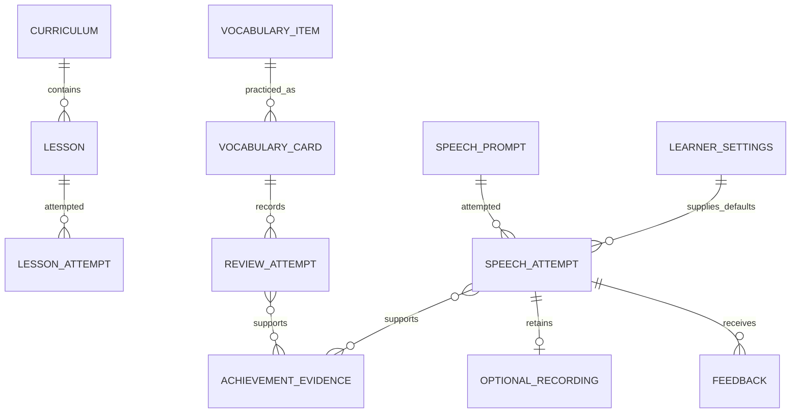

# Conceptual Entity Relationships

> **v2 note (2026-10-25):** kept for online AI coaching, which is now Phase 6 in the [development plan](../development-plan/development-plan.md). Sections that mention v1 tickets, Speech Lab trainers or delivery groups are history; see [history-version.md](../history-version.md).

> Status: IN_PROGRESS
> Domain relationships only; not a physical database schema.

Recognition/use cards have separate histories. Improvement evidence references attempts and rule versions; physical storage, deletion cascades and schema types remain open.

SC-T002 selects local-only SwiftData with separate private audio files. SC-T004 defines component deletion identities/deadlines, learner epoch, durable cleanup and minimal retained participation-event identity; relationships above remain conceptual. See the reconciled contract before physical schema work. No migration or schema exists.
