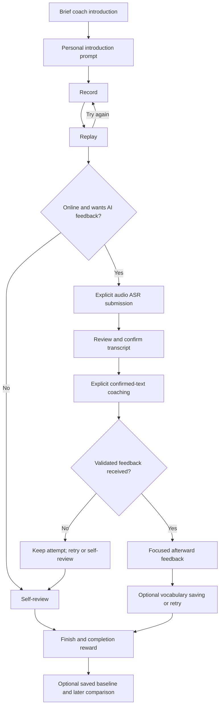
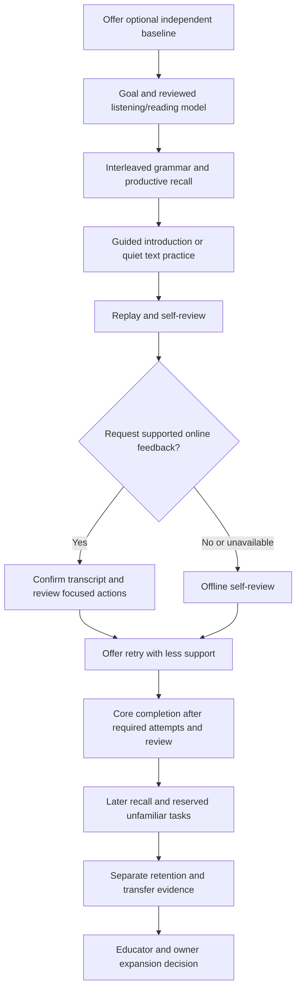
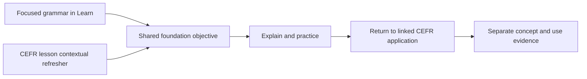
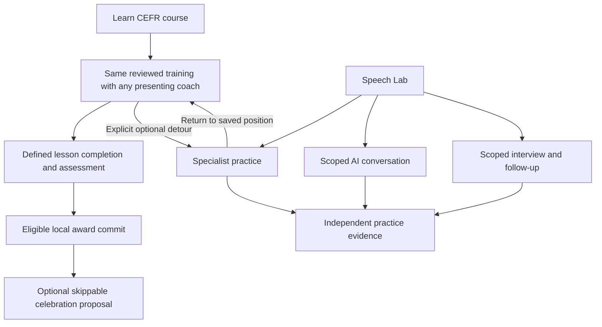

# First Speaking User Journey

> Status: IN_PROGRESS
> Approved first-flow design inputs; conceptual behavior only, no runtime acceptance.

First-session recording does not lock level. Improvement badges need evidence beyond participation. Other speaking modes are planned, not depicted as implemented screens.

## Introductions teaching and evaluation loop

Conceptual adopted flow; [INTRO-01](../product-specification/introductions-learning-loop.md) owns exact criteria. Optional baseline and delayed checks do not block core completion.

Assisted attempts remain practice; quiet completion does not establish speaking ability. Independent audio/text retention is optional throughout. See [IL protocol](../testing/introductions-learning-acceptance.md) for timing, support and pilot gates.

## Foundations within Learn

Conceptual adopted behavior; [English Foundations](../../../product-specification/english-foundations.md) owns scope and evidence rules.

Both paths preserve objective progress and originating lesson context. Foundations never become a mandatory level lock; first delivery includes only the reviewed Introductions subset.

## Course versus independent practice

Conceptual clarification from [course/practice requirements](../product-specification/learning-path-and-practice.md):

Practice evidence cannot auto-complete the course or advance levels. Turn-based availability is distinct from deferred live voice capability; presentation/animation never grants the award.
