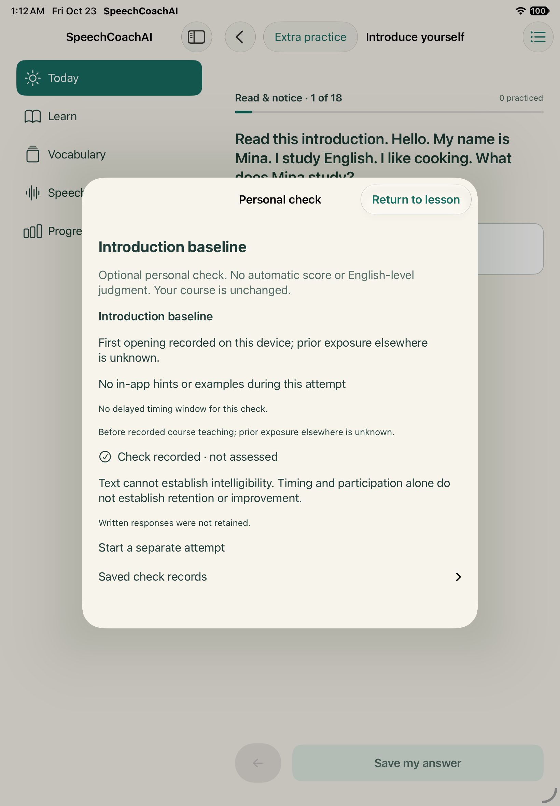

# Connected speaking and personal checks · 2026-10-23

## Source and behavior

[Implementation record](../../../development-plan/connected-practice-2026-10-23.md). Codex implemented SC-T021 runtime connections; Grok supplied scheduler integrity changes under its separate ownership. Final source hashes are recorded in source-checkpoints.json. No schema migration, live provider call, physical install or learner-store reset.

- Specialist recording freezes the real selected prompt plus role/method/pack/activity/source objectives. Restart recovery restores that context. Course completion matches exact source journey/activity and course purpose. Declining retained payloads strips the new provenance too.
- Baseline, repeated baseline, two transfer situations and five-item day-7/day-28 checks use separate durable journals. Conditions/retention/exposure/purpose freeze before prompts. Follow-up is hidden until the preceding attempt. No model answers or online coaching during checks. Missing date/out-of-window timing remains explicit; intervening practice is self-report.
- Typed text retention is opt-in; non-retained responses leave only participation/modality. Completed checks and opted-in drafts resume. Recording retention stays independent. Checks cannot complete course activities or schedule vocabulary. Earlier records are accessible; delete-all clears the journals.
- Manual recall/grammar/follow-up/clarity choices explain their destination. Progress shows delayed/transfer check participation, never automatic success or English level.

## Verification checkpoints

- `provenance.xcresult`: focused CaptureRecoveryTests passed, including actual prompt/context round-trip through repository close/reopen, and minimization when retention is declined.
- `checks.xcresult`: initial iPhone simulator combined run passed **112 tests**, zero failures. See phone-integration-summary.json. Includes baseline follow-up staging, restart and course non-completion, plus optional specialist navigation. This preceded the final history/progress/draft refinements and presentation fix.
- `final-tablet.xcresult`: hosted tests and baseline UI passed; the added exact Journalist recording-prompt assertion failed. The Boolean presentation could construct the recorder without the selected context. Corrected to an item-driven full-screen presentation carrying its immutable context; the exact-prompt assertion now waits for displayed content. This failure remains part of the evidence, not erased.
- `tablet-retest.xcresult`: final source **114 tests passed** (112 hosted, two UI journeys), zero failures. Exact Journalist prompt, check follow-up/restart/course isolation, and full hosted regression including Grok scheduler integrity passed. See tablet-retest-summary.json. Synthetic corruption tests deliberately emit Core Data errors for invalid stores; those cases passed and are not app-store loss evidence.

Tests use Xcode scheme SpeechCoachAI, explicit iPhone 18 Pro / iPad A16 simulators (OS 27.0), ad-hoc simulator signing and serial execution. Bundles/logs remain in ignored application/.build/connected-practice-2026-10-23/. No physical-device result is claimed.

## Remaining acceptance

Physical recording/routes/accessibility, full retention/interruption matrix and owner/content/learning acceptance remain outstanding. These personal draft prompts are not a qualified comparable assessment protocol; no scoring or learning success is claimed. Grok delivered the full six-question reading/listening version 3 pack during this batch; its hosted catalog checks passed in the final tablet run. SC-T018 retains the full rubric/anchor/specialty audit and publication review. Broader SC-T043 pilot results remain separate. Simulator completion is not full ticket closure.

Inspected the final tablet personal-check screenshot: readable native hierarchy and explicit return, purpose, support, timing and not-assessed status. This does not replace physical accessibility acceptance.

Final iPhone presentation regression: **2 UI journeys passed**, zero failures, on the same app sources as the final tablet. See phone-final-summary.json. The complete-course UI test was then updated for Grok’s four additional comprehension activities; its separate execution result is recorded below.

Complete-course version 3 UI regression: **1 journey passed**, zero failures, on iPhone simulator. It saves/restarts the draft, attempts all 18 required activities (three reading, three listening, five grammar, five recall, guided/quiet attempt, self-review), finishes the course, enrolls a vocabulary sense and enters rated review. See core-v3-summary.json. This proves runtime flow with synthetic responses, not correctness of learner answers, audio comprehension or learning success.
