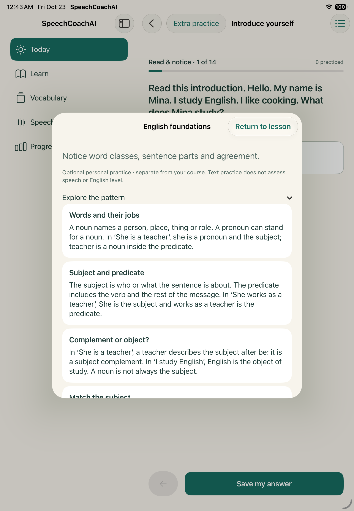

# INTRO offline practice and catalog integration · 2026-10-23

## Delivered behavior

Optional English Foundations, Teacher, Grammarian and Journalist routes open from INTRO-01 Extra practice. Each has its own saved journey, method and source-course reference. Opening/returning preserves the course draft and position. Attempts, retries, revealed examples and restart state persist locally; first responses remain separate. No practice route completes the course, credits vocabulary scheduling or claims speech/CEFR assessment. Foundation version 2 requires five concept attempts, five production attempts, linked application, example review and self-review; wrong answers do not block completion. Existing version 1 records remain stored separately.

Grok's catalog metadata and validation are integrated. The player consumes optional choice sets and explanations, with legacy fallback. Duplicate identities and malformed metadata fail only affected lessons. Required course items, answers and assets are unchanged. Content remains personal-use material, not qualified editorial approval.

## Executed checks

- `combined.xcresult`: iPhone 18 Pro simulator, iOS 27.0; **105 test cases passed**, zero failures, including hosted suites and the optional-practice UI journey. Parameterized cases yield 124 device executions. See combined-summary.json.
- `tablet-final.xcresult`: iPad A16 simulator, iPadOS 27.0; **105 test cases passed**, zero failures. See tablet-summary.json. This preceded the final foundation-production/completion extension and the last player metadata wiring; it does not verify those later edits.
- UI journey saves a course draft, opens foundation practice, saves/reveals a response, returns with the course draft unchanged, relaunches, resumes the saved optional response and opens the three distinct specialist routes.
- Hosted cases cover pack/course isolation, retained first response versus retry, old-record compatibility and delete-all. Catalog cases cover optional metadata, malformed choices and duplicate identities without sibling failure.
- `foundation-final.xcresult`: final source, iPhone simulator; **11 tests passed**, zero failures (10 journey tests plus the optional-practice UI journey). Includes the new five-production/review completion regression. See foundation-final-summary.json. Final source hashes are in source-checkpoints.json; earlier test checkpoints must not be represented as the same source revision.

Bundles/logs remain under ignored `application/.build/intro-practice-2026-10-23/`. xcodebuild used ad-hoc simulator signing, parallel testing disabled, the existing project/scheme and explicit selected tests. No live provider request, physical install, migration or learner-data reset was performed.

## Visual inspection and remaining acceptance

Inspected the phone and tablet screenshots. The optional route uses the existing palette/cards and a native sheet with an explicit return action. Tablet teaching content scrolls within the sheet. Screenshots do not prove accessibility or device acceptance. Physical airplane-mode/install/update/disk-full checks, full accessibility and content/learning acceptance remain open. SC-T018 content breadth and SC-T021 speaking/assessment work are still implementation work.

