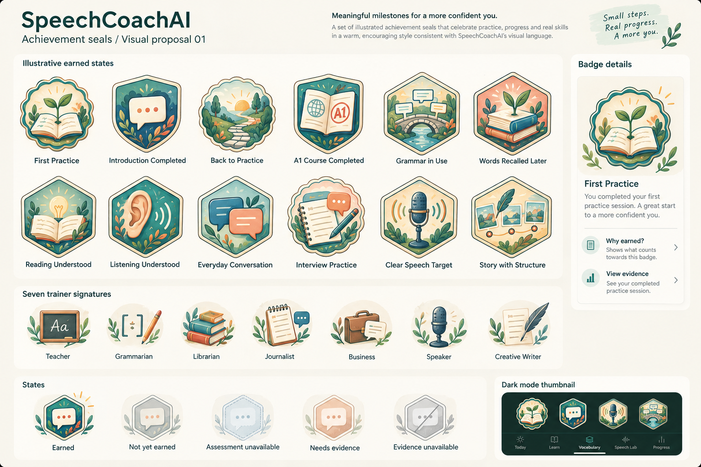

# Achievement visual system — adopted v1

> Owner adopted this complete visual system on 2026-10-19 (Asia/Manila) after adopting the 68-family catalog. Shapes, palette, category/role subjects, all 68 mappings, tier/state treatments, surface hierarchy and initial motion/composition targets are now product requirements. The 68 base PNG masters are delivered (see below); vector/small-size exports, qualified learning-rubric validation, operational activation, Figma implementation and native/device verification remain pending; they do not reopen visual-direction selection.

## Adopted visual reference

Generated with the built-in ImageGen tool using the two inspected local Page 1 exports as style references. This is one representative concept board, not 68 final assets, a live app screen or an edit of the Figma file. Some short sample labels summarize scoped catalog family names; production must use the exact AW ID/name and native accessible text. Detailed illustration must be simplified for 32 pt use; native layout/contrast/accessibility are not validated by this image. The board uses the completion shield to illustrate state variations; apply the same state treatment to each family’s own shell.

Generation prompt and references: [prompt record](achievement-visual-proposal-v1.prompt.md).

## Direction: illustrated achievement seals

Warm paper-and-enamel emblems with confident deep-ink outlines, restrained layered illustration, small tactile shadows and controlled hand-painted texture. Match the retained Page 1 editorial typography and mixed-media coach artwork rather than introducing a new game aesthetic. Use [local foundations](../../tools/figma-local-helper/consolidation/review/speechcoach-kit-01.png) and [appearance/characters](../../tools/figma-local-helper/consolidation/review/speechcoach-kit-05.png) as the inspected style references. No Figma page/file has been edited.

Design one reusable shell/state/tier system, then supply each family’s subject illustration. Do not draw 68 unrelated trophies, make every milestone a collectible, use bronze/silver/gold rarity ranks or treat higher CEFR course completion as a more expensive item. This adopted system changes presentation only, not catalog earning rules, currencies or course progression.

## Meaning through silhouette

| Catalog classification | Adopted treatment | What it communicates |
| --- | --- | --- |
| Participation / consistency | Soft round medallion, gently scalloped outer rim, single ink contour | An eligible practice/return event; no verified-skill implication |
| Collectible activity/course/foundation completion | Rounded passport shield, small paper tab, simple inset frame | A defined reviewed completion set, with course/strand label outside |
| Evidence-based learning / trainer skill | Rounded hexagon, restrained double inset frame, small evidence marker accompanied by a text category | A specific evidence-supported objective; not official certification or global mastery |
| Per-lesson/topic/unit milestone | Compact native progress row/checkpoint with the relevant page/folder/book icon | Progress record, not another collectible badge or payout |
| XP / gold / operational indicators | Small consistent metric chip, wallet/list entry or goal indicator | Economy/status, never a skill seal |

Do not rely on shape or color alone: show Participation, Completion or Demonstrated learning in detail and an accessible label. Border treatment identifies category, not current evidence validity; an evidence hexagon with unavailable support must explicitly say so. All shells preserve the same optical scale so a learning badge is not automatically larger/more valuable than a completion badge.

## Color and illustration language

Palette anchors sampled visually from the retained foundation specimen: warm cream #F7F4EC; deep ink #213D39; teal #176C60; sage #E1EBE3; coral #E9A28A; Atlas blue #285E86; Studio indigo #434B85. These are adopted art palette anchors, not a replacement for reviewed semantic UI tokens or proof of runtime contrast. Use ink for essential outlines/text; keep texture away from labels and small icon silhouettes.

| Category | Adopted accent | Visual subject language |
| --- | --- | --- |
| First practice | Teal/sage with small coral accent | Workbook, sprout, first step |
| Consistency | Coral/cream with teal outline | Calendar, linked dates, returning path |
| Course progress | Teal/cream; Atlas blue on the course tab | Passport workbook and level designation |
| Foundations | Indigo/sage | Word tiles, sentence construction and connected paper strips |
| Vocabulary / comprehension | Sage/teal with blue reference accents | Book, word card, ear, scene/window |
| Conversation | Atlas blue/coral | Linked dialogue panels with clear direction |
| Interview | Indigo/coral | Notebook, grounded answer details, follow-up card |
| Communication | Teal/Atlas blue | Message cards, source summaries and audience questions |
| Articulation | Atlas blue/sage | Microphone, gentle sound grouping, word retrieval |
| Creative expression | Indigo/coral on cream | Quill, draft and story panels |
| Trainer signatures | Shared profession-tool icon within the appropriate completion/skill shell | Consistent role identity across both awards; never a separate rarity rank |

Category accents are stable across Creative Academy, Adventure Atlas and Mixed-Media Studio. Background appearance changes the surrounding app surface, not what a badge means. Dark mode uses a deep-ink outer surface with a cream/sage illustration inset and a clear edge; do not simply dim the entire badge. Confirm contrast and recognition on actual screens before acceptance. Tiny badge views use simpler art, not unreadable texture.

## Seven trainer signatures

| Trainer | Adopted profession emblem | Completion versus skill |
| --- | --- | --- |
| Elephant Teacher | Chalkboard and chalk | Same emblem in completion shield / evidence hexagon |
| Owl Grammarian | Sentence brackets and pencil | Same pair of shells |
| Bear Librarian | Stacked books and bookmark | Same pair of shells |
| Fox Journalist | Reporter notebook and pencil | Same pair of shells |
| Tiger Business Professional | Briefcase and dialogue card | Same pair of shells |
| Parrot Speaker | Microphone and grouped phrase arcs | Same pair of shells |
| Creative Writer | Quill and story paper | Same pair of shells; no new animal or character name is invented |

The profession tools remain recognizable at small sizes and avoid redrawing full coach portraits on every badge. Optional original coach cameo belongs on a large reveal/result page, not inside every miniature. Creative Writer’s animal/name/artwork/voice remains a separate open design choice; a quill emblem does not select it.

## Tier and parameter treatment

Keep the same family illustration as an adopted tier progresses; change the external numeric tab (e.g. 10, 30, 100, 365 practice dates) and show the unit in text. Add a restrained segmented progress edge only when its denominator is meaningful and available. No metallic rarity progression, mystery chests or new tier thresholds. A1–C2 appear as course labels on the same completion shield, with “Course completed” always visible in details; do not imply certification.

Parameterized Grammar in Use, sense-set and trainer skill awards retain a consistent family symbol; show the actual target/lesson/objective outside the artwork. Do not typeset long curriculum names inside tiny icons or generate unique art per sentence/word sense. Distinct rule/objective instances remain distinct in the data even when the art asset is reused.

## States

| State | Adopted appearance | Required text/action behavior |
| --- | --- | --- |
| Earned | Full illustration color and finished outline | Earned date, actual category/criterion, related practice and permitted evidence |
| Not yet earned | Muted but recognizable subject and unfilled/soft rim | Explain the next eligible activity; no padlock or gold-unlock price |
| Not yet available | Soft neutral illustration with small calendar/info marker | State missing published content or supported assessment; do not imply learner failure |
| Insufficient evidence | Illustration retained with a small outlined evidence marker | “More evidence needed” plus the exact missing check; no false verified-skill mark |
| Supporting evidence unavailable | Keep historically earned identity where policy permits, with a clear info marker | “Supporting evidence unavailable”; distinguish historical award from current substantiated skill, without resurrecting deleted recordings |

One-time earned presentation is not repeated whenever a card appears. No essential color-only, glow-only or animated-only state distinction. Label small variants accessibly. Final historical-award/invalidation policy must be resolved before claiming an award remains currently verified.

## Surfaces and composition

- **Achievements overview:** compact category/claim-type filters and relevant available/earned items first. Adaptive cells with emblem above a readable short name/category; expand long labels rather than truncating essential meaning. Do not initially expose a wall of every unearned parameterized instance.
- **Badge detail:** larger emblem, name, category, scope/target, earned date/state, Why earned?, reviewed criterion, supporting evidence availability and related practice. Show no fabricated XP/gold payout for a badge.
- **Completion result:** selected coach and one new relevant badge (or grouped awards), real itemized reward summary and immediately enabled Continue. Rare decorative gesture is skippable; result text stays static/readable.
- **Course path:** use native checkpoint rows/page-folder-book symbols for CR-01/02/03, reserving collectible shields for explicit course completion badges. Coach selection never changes path art semantics or course rules.
- **Wallet and daily goals:** XP/gold, active-time/activity/plan, streak/protected-date state remain simple metrics. Gold is a currency icon, not a bronze/silver/gold badge tier.

Adopted initial art composition targets: 32 pt simplified inline icon; 72–96 pt grid emblem; 144–176 pt detail/reveal emblem. Labels remain native text outside the asset with Dynamic Type. These are composition targets, not verified native acceptance or mandatory screen dimensions. Use actual iPhone/iPad reflow and accessibility review; preserve Page 1 control/navigation patterns. No new top-level tab.

## Motion

Use the adopted [celebration design](celebrations-badges-and-rewards.md): target 200 ms gentle reveal and at most 800 ms contained rare accent, with Skip/Continue available immediately. Static equivalent under Reduce Motion; quiet/sound/haptic preferences respected. No perpetual sparkle, shaking, flashing or animated currency needed to understand a balance. The motion targets are design requirements, not measured performance or an instruction to implement the app during this documentation update.

## One-to-one family subject map

Every adopted family has an adopted presentation/symbol below. This maps all 68 families without claiming 68 production assets; shells, profession signatures and parameterized icons are reused.

| Award ID | Adopted family | Adopted presentation | Adopted subject |
| --- | --- | --- | --- |
| AW-P-01 | First Practice | Participation circle | Sprout emerging from an open practice workbook |
| AW-P-02 | Introduction Completed | Completion shield | Friendly introduction speech card |
| AW-P-03 | First Lesson | Completion shield | Open lesson workbook with a completed page corner |
| AW-P-04 | First Rated Review | Participation circle | Recall card turned over beside a small bookmark |
| AW-P-05 | First Speaking Self-review | Participation circle | Microphone and a replay loop |
| AW-P-06 | First Conversation | Participation circle | Two overlapping dialogue panels |
| AW-P-07 | First Interview | Participation circle | Interview notebook with two dialogue panels |
| AW-P-08 | First Story | Participation circle | Quill and a three-panel story strip |
| AW-C-01 | Back to Practice | Participation circle | Stepping stones returning toward a sunrise |
| AW-C-02 | Practice Days | Participation circle | Calendar page and small trail of date dots |
| AW-C-03 | Practice Streak | Participation circle | Connected calendar chain, with protected-date distinction in details |
| AW-C-04 | Daily Plans Completed | Completion shield | Daily checklist with a completed circle |
| AW-C-05 | Welcome Back | Participation circle | Open doorway with a small returning path |
| AW-CR-01 | Lesson Completed — {lesson} | Progress row / checkpoint, no collectible seal | Completed lesson page |
| AW-CR-02 | Topic Completed — {topic} | Progress row / checkpoint, no collectible seal | Tabbed topic folder |
| AW-CR-03 | Unit Completed — {unit} | Progress row / checkpoint, no collectible seal | Bound unit book |
| AW-CR-04 | A1 Course Completed | Completion shield | Passport workbook marked A1 |
| AW-CR-05 | A2 Course Completed | Completion shield | Passport workbook marked A2 |
| AW-CR-06 | B1 Course Completed | Completion shield | Passport workbook marked B1 |
| AW-CR-07 | B2 Course Completed | Completion shield | Passport workbook marked B2 |
| AW-CR-08 | C1 Course Completed | Completion shield | Passport workbook marked C1 |
| AW-CR-09 | C2 Course Completed | Completion shield | Passport workbook marked C2 |
| AW-CR-10 | English Course Path Completed | Completion shield | Six linked course volumes and an open path |
| AW-EF-01 | Word Types Completed | Completion shield | Word tiles grouped around a small dictionary page |
| AW-EF-02 | Sentence Structure Completed | Completion shield | Sentence blocks forming a clear bridge |
| AW-EF-03 | Agreement and Verb Forms Completed | Completion shield | Two interlocking subject/verb tiles |
| AW-EF-04 | Phrases and Clauses Completed | Completion shield | Branching phrase-and-clause paper strips |
| AW-EF-05 | Progressive Grammar Completed | Completion shield | Clock and linked verb-form pages |
| AW-EF-06 | Grammar in Use — {child objective} | Evidence hexagon | Sentence bridge with the named target on the external label |
| AW-LE-01 | Words Recalled Later — {sense set} | Evidence hexagon | Book and sprout with two revisit dots |
| AW-LE-02 | Words in a New Context — {sense set} | Evidence hexagon | Word card connected to a new scene window |
| AW-LE-03 | Introduction in a New Situation | Evidence hexagon | Introduction card opening onto a different scene |
| AW-LE-04 | Reading Understood — {objective} | Evidence hexagon | Open book with a focused reading light |
| AW-LE-05 | Listening Understood — {objective} | Evidence hexagon | Ear and gentle source-sound arcs |
| AW-CV-01 | Conversation Practice | Participation circle | Pair of dialogue cards and a visible tier tab |
| AW-CV-02 | Relevant Follow-ups — {objective} | Evidence hexagon | Response bubble branching into a relevant question |
| AW-CV-03 | Clarification in Use — {objective} | Evidence hexagon | Question bubble becoming a clarified response |
| AW-CV-04 | Everyday Scenario Achieved — {scenario objective} | Evidence hexagon | Small everyday scene window with a completed dialogue route |
| AW-IV-01 | Interview Practice | Participation circle | Interview notebook and tier tab |
| AW-IV-02 | Experience Explained — {objective} | Evidence hexagon | Experience note with two grounded detail tabs |
| AW-IV-03 | Interview Follow-up Handled — {objective} | Evidence hexagon | Answer card followed by a linked question/answer pair |
| AW-IV-04 | Interview Transfer — {role/objective} | Evidence hexagon | Interview notebook opening into a new comparable scene |
| AW-CM-01 | Clear Message — {objective} | Evidence hexagon | Clear central message with two supporting lines |
| AW-CM-02 | Accurate Summary — {objective} | Evidence hexagon | Source sheet folded into three accurate summary lines |
| AW-CM-03 | Listening and Responding — {objective} | Evidence hexagon | Ear and source-linked reply bubble |
| AW-CM-04 | Supported Opinion — {objective} | Evidence hexagon | Message card with balanced supporting evidence tabs |
| AW-CM-05 | Constructive Disagreement — {objective} | Evidence hexagon | Two different dialogue panels connected by a respectful bridge |
| AW-CM-06 | Presentation and Questions — {objective} | Evidence hexagon | Presentation board beside audience question cards |
| AW-AR-01 | Clear Speech Target — {target} | Evidence hexagon | Microphone and grouped gentle sound arcs |
| AW-AR-02 | Word-finding in Use — {objective} | Evidence hexagon | Small meaning cue linked to a retrieved word card |
| AW-AR-03 | Paraphrase in Use — {objective} | Evidence hexagon | Two differently shaped word cards connected by the same meaning thread |
| AW-WR-01 | Story with Structure — {objective} | Evidence hexagon | Three linked story panels and a quill |
| AW-WR-02 | Purposeful Revision — {objective} | Evidence hexagon | Draft page with one purposeful revised line |
| AW-WR-03 | Story Retold — {objective} | Evidence hexagon | Story strip retold through a second scene window |
| AW-TR-01C | Teacher Practice Completed | Completion shield | Small chalkboard and chalk |
| AW-TR-01S | Teacher: Independent Application — {objective} | Evidence hexagon | Small chalkboard and chalk |
| AW-TR-02C | Grammarian Practice Completed | Completion shield | Sentence brackets and pencil |
| AW-TR-02S | Grammarian: Grammar Applied — {objective} | Evidence hexagon | Sentence brackets and pencil |
| AW-TR-03C | Librarian Practice Completed | Completion shield | Stacked books and bookmark |
| AW-TR-03S | Librarian: Meaning Recalled and Used — {objective} | Evidence hexagon | Stacked books and bookmark |
| AW-TR-04C | Journalist Practice Completed | Completion shield | Reporter notebook and pencil |
| AW-TR-04S | Journalist: Questions and Accurate Summary — {objective} | Evidence hexagon | Reporter notebook and pencil |
| AW-TR-05C | Business Professional Practice Completed | Completion shield | Briefcase with a dialogue card |
| AW-TR-05S | Business Professional: Purposeful Workplace Exchange — {objective} | Evidence hexagon | Briefcase with a dialogue card |
| AW-TR-06C | Speaker Practice Completed | Completion shield | Microphone with phrase arcs |
| AW-TR-06S | Speaker: Intelligible Target Delivery — {objective} | Evidence hexagon | Microphone with phrase arcs |
| AW-TR-07C | Creative Writer Practice Completed | Completion shield | Quill and story paper |
| AW-TR-07S | Creative Writer: Coherent Creative Expression — {objective} | Evidence hexagon | Quill and story paper |

## Prototype and production boundary

The owner accepted the representative board and this system as the visual reference. The board remains illustrative concept art, not a live achievement screen, earned learner history or the full production asset library; its original filename and generation prompt preserve proposal provenance. Subsequent production work creates editable vector/layered masters and small-size variants with consistent optical weights, following the accepted subject map and original/local approved artwork. Native text/state overlays remain separate from raster illustrations. New direction selection is not a prerequisite; asset fidelity and native usability still need verification.

Do not generate the full instance library, change Figma, install animation dependencies or implement the app as part of this documentation update. SC-T007 verifies production specimen fidelity to the adopted system; SC-T025 refines the adopted catalog’s activation details and visual/asset implementation children; SC-T024 integrates evidence/state surfaces. Exact asset files/export sizes and native rendering APIs remain subsequent implementation decisions; refinements must preserve the adopted appearance and meaning.

## Production and native verification criteria

- All 68 adopted IDs map once to a subject/presentation; CR milestones remain noncollectible and XP/gold stay separate.
- Participation/completion/learning are recognizable by silhouette plus accessible text; labels/meaning remain intact at small sizes, dark mode and all backgrounds.
- Seven trainer completion/skill pairs visibly share profession identity without unlocking coaches or inventing a Writer animal.
- Tier variants preserve subject and use adopted numeric/unit labels; no rarity values, CEFR promotion or extra currency is introduced.
- All five evidence/availability states are truthful and distinct, including neutral unavailable/deleted-support handling.
- Device accessibility/motion/contrast/VoiceOver/Dynamic Type and actual native layout are checked separately from the static concept board; none is currently PASS from image generation.

Both the catalog and visual system are owner-adopted. Production assets, Figma persistence, device acceptance and learner/UI validation remain unverified. Use AV-QA01–AV-QA08 in [acceptance](../history/v1/testing/course-practice-and-rewards-acceptance.md); do not infer runtime PASS from design approval.

## Raster library delivered — 2026-10-20

[Asset library](../../assets/awards/v1/README.md) · [gallery](../../assets/awards/v1/gallery.html) · [manifest](../../assets/awards/v1/manifest.json) · [static verification](../../assets/awards/v1/verification.json).

All 68 adopted families now have individual transparent 1254 × 1254 RGBA PNG base illustrations, including the three unframed milestone icons and all seven trainer completion/skill pairs. Each has its exact generation prompt, reference path, original source record and static inspection note. The lesson checkpoint was corrected from an open book to a loose page; the rejected original is retained.

Coverage, unique hashes, PNG integrity and alpha checks passed for all 68 files. Main solid silhouettes have at least 57 px canvas margin; faint low-alpha edge artifacts remain possible. Static review confirms the mapped subjects and shell language at master scale, not final native optical sizing or full AV-QA acceptance. Simplified 32 pt variants, editable vector/layered masters, native state/tier/evidence markers and labels, animation, actual device/themed/accessibility checks remain pending. The gallery supplies review controls but its browser behavior was not executed because local browser use was disabled in Work settings. This delivery does not activate awards or alter earning rules.
